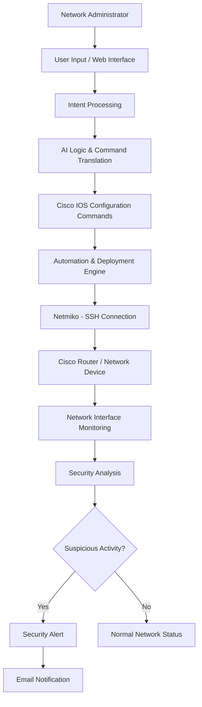

# 🌐 Real-Time Network Device Configuration and Security Monitoring System Using NLP and LLM

## 📌 Project Overview

The **Real-Time Network Device Configuration and Security Monitoring System** is an AI-assisted network automation and security monitoring project developed using Python, NLP concepts, and network automation technologies.

The system allows network administrators to configure Cisco network devices using simple natural language instructions instead of manually entering complex CLI commands.

It converts user instructions into Cisco IOS configuration commands and automatically deploys them through secure SSH connections using Netmiko.

Additionally, the system monitors network interfaces to identify unauthorized active interfaces and trusted interface failures. It generates security alerts to help administrators identify suspicious network activities.

## 🎯 Objectives

- Simplify network device configuration using natural language.
- Reduce manual configuration effort and human errors.
- Automatically generate Cisco IOS commands.
- Deploy configurations through secure SSH connections.
- Monitor network interfaces continuously.
- Detect unauthorized active interfaces and interface failures.
- Generate email alerts for detected security issues.

## ✨ Key Features

- **Natural Language Input:** Accepts simple instructions from users.
- **Automated Command Generation:** Converts recognized network intents into Cisco IOS commands.
- **SSH-Based Deployment:** Uses Netmiko to communicate with Cisco routers.
- **Network Monitoring:** Checks interface status and protocol status.
- **Unauthorized Interface Detection:** Identifies active interfaces that are not in the authorized list.
- **Trusted Interface Monitoring:** Detects when authorized interfaces become inactive.
- **Automated Email Alerts:** Sends notifications when suspicious conditions are detected.
- **Scheduled Monitoring:** Performs periodic network checks.

## 🏗️ System Architecture

The architecture consists of five major components that work together to automate network configuration and security monitoring.



## 🔄 Project Workflow

The system follows the workflow below:

**Step 1: User Input**

The administrator enters a natural language instruction, such as:

- Configure SSH.
- Enable logging.
- Configure gateway.
- Enable OSPF.
- Check network status.

**Step 2: Intent Processing**

The system receives the instruction and identifies important keywords to understand the requested network operation.

**Step 3: Command Generation**

The AI logic module interprets the identified intent and generates the corresponding Cisco IOS configuration commands in the correct execution order.

**Step 4: Configuration Deployment**

Netmiko establishes an SSH connection with the Cisco router and automatically deploys the generated configuration commands.

**Step 5: Security Monitoring**

The monitoring module collects interface information using the Cisco `show ip interface brief` command.

**Step 6: Threat Detection**

The system checks:

- Unauthorized interfaces that are active.
- Authorized interfaces that are down.
- Abnormal interface conditions.

**Step 7: Alert Generation**

If suspicious activity is identified, the system generates security alerts and sends email notifications through the scheduled monitoring module.

**Step 8: Final Output**

The administrator receives the configuration status and monitoring results.

## 🧩 Modules Description

| Module | Description |
|---|---|
| Intent Processing | Accepts and processes natural language instructions. |
| AI Logic & Command Translation | Maps recognized keywords to Cisco IOS commands. |
| Automation & Deployment | Deploys configurations using Netmiko and SSH. |
| Security Monitoring | Checks trusted and unauthorized network interfaces. |
| Performance Evaluation | Evaluates configuration accuracy, deployment success, detection accuracy and alert response time. |

## 🛠️ Technologies Used

| Technology | Purpose |
|---|---|
| Python | Backend development |
| NLP | Natural language intent processing |
| AI Logic | Network command generation |
| Netmiko | Network device automation |
| SSH | Secure device communication |
| Cisco IOS | Network device configuration |
| GNS3 | Network topology simulation |
| Flask | Web application interface |
| APScheduler | Periodic monitoring |
| SMTP | Email alert notifications |

## 📂 Project Structure

```text
Network-Security-Monitoring/
│
├── app.py
├── main.py
├── ai_engine.py
├── deploy_config.py
├── monitor.py
├── scheduler.py
├── email_alert.py
│
├── templates/
│   └── index.html
│
├── screenshots/
│
├── requirements.txt
│
└── README.md
```

## ⚙️ Installation and Setup

### 1. Clone the Repository

```bash
git clone https://github.com/your-username/your-repository.git
```

### 2. Navigate to the Project Folder

```bash
cd Network-Security-Monitoring
```

### 3. Install Required Libraries

```bash
pip install flask netmiko apscheduler
```

### 4. Configure Network Details

Update the router IP address, username, password and SSH connection settings in the configuration files.

### 5. Run the Application

For the web interface:

```bash
python app.py
```

For terminal-based execution:

```bash
python main.py
```

### 6. Test the System

Enter natural language instructions and check the generated configuration commands, deployment results and security monitoring alerts.

**Note:** A compatible Cisco IOS router or GNS3 network simulation environment with SSH access is required for deployment and monitoring.

## 📸 Project Screenshots

### AI Chatbot Interface

_Add your chatbot screenshot here._

### Network Topology

_Add your GNS3 topology screenshot here._

### Network Configuration

_Add your router configuration screenshot here._

### Security Monitoring

_Add your unauthorized interface detection screenshot here._

### Email Security Alerts

_Add your email alert screenshot here._

## 📊 Performance Evaluation

The system evaluates its performance using the following parameters:

- Intent Processing Accuracy
- Configuration Deployment Success Rate
- Security Detection Accuracy
- Alert Response Time
- Network Availability

## 🚀 Future Enhancements

- Integration with multiple network vendors such as Juniper, Huawei and Arista.
- Integration of a database for historical network logs.
- Advanced AI models for improved intent understanding.
- Enhanced web-based monitoring dashboard.
- Automated threat response mechanisms.
- Predictive network analysis.

## 🎓 Project Information

**Project Domain:** Cybersecurity & Network Automation

**Project Type:** Final Year Academic Project

**Development Year:** 2026

**Institution:** K.L.N. College of Engineering

---

⭐ If you find this project useful, consider giving this repository a star!

**Disclaimer:** This project is developed for educational and network security testing purposes. Use it only in authorized network environments.
